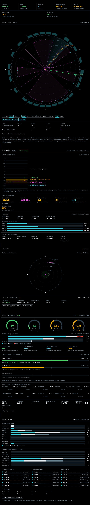

# MeshCore HUD

Six Lovelace cards for the [MeshCore Home Assistant integration](https://github.com/meshcore-dev/meshcore-ha). The cards use an EFIS / TCAS display style: dark glass, cyan for data, magenta for limits and own-ship, green / amber / red for margin.



The screenshot uses test data, not a real mesh.

| Card | Shows |
|---|---|
| `meshcore-status-card` | One row of system state: gateway, relay, nodes heard, worst link margin, noise floor, channel load, trackers. |
| `meshcore-scope-card` | Polar plot of all nodes by bearing and distance from home. Direct links from the relay, colour by fade margin. Reach envelope and sector counts. |
| `meshcore-link-card` | Signal and noise ladder in dBm, the link margin that excess noise costs you, collision estimate, time on air by packet size. |
| `meshcore-tracker-card` | Tracker status, proximity plot with 72 h trail, route trace. |
| `meshcore-relay-card` | Repeater telemetry: battery, duty, noise floor, traffic flow, neighbour SNR and fade margin, 7-day trends. |
| `meshcore-census-card` | Histograms of advert age and distance, nearest / farthest / latest lists, contact store health. |

## Requirements

- Home Assistant 2024.8 or later.
- [meshcore-ha](https://github.com/meshcore-dev/meshcore-ha) v3.0 or later, with a companion radio as the gateway. Tested on v3.0.2.
- Contact entities must be on (`binary_sensor.meshcore_<prefix>_contact`). The scope, census and tracker cards read these. In data-only mode the integration does not make these entities, and these cards show no nodes.
- For the relay card and the link lines on the scope: add the repeater to the integration as a monitored repeater, with telemetry and the neighbour table on. This makes the `sensor.meshcore_<relay>_neighbor_<hex>` entities.
- The cards need no other custom cards.

## Install

### HACS (custom repository)

1. HACS > three-dot menu > **Custom repositories**.
2. Add `https://github.com/Eastyuk/meshcore-hud`, type **Dashboard**.
3. Install **MeshCore HUD**, then reload the browser.

### Manual

1. Copy `dist/meshcore-hud.js` to `/config/www/meshcore-hud.js`.
2. Settings > Dashboards > three-dot menu > **Resources** > Add resource:
   URL `/local/meshcore-hud.js`, type **JavaScript module**.
3. Reload the browser.

### Font (optional)

The cards use the [B612](https://fonts.google.com/specimen/B612) font (designed for Airbus cockpit displays, OFL licence). If B612 is not loaded, the cards use Roboto. To load B612, add one more resource:

URL `https://fonts.googleapis.com/css2?family=B612:wght@400;700&display=swap`, type **Stylesheet**.

This makes each browser request the font from Google. For a site with no internet access, download the woff2 files, put them in `/config/www/`, and add a local stylesheet with `@font-face` rules.

## Find your prefixes

Each card refers to nodes by the public key prefix that the integration puts in its entity IDs. Open Settings > Entities and search `meshcore_`.

| Node | Example entity | Prefix to use |
|---|---|---|
| Gateway (companion radio) | `sensor.meshcore_aabbcc_node_status_mygw` | `aabbcc` |
| Monitored repeater | `binary_sensor.meshcore_1122334455_online_myrelay` | `1122334455` |
| Tracker (any contact) | `binary_sensor.meshcore_9988776655_contact` | `9988776655` |

A tracker prefix can be shorter than the full one. The card uses the first contact whose key starts with it.

## Example

See [`examples/meshcore-overview.yaml`](examples/meshcore-overview.yaml) for a full view. Minimum config for each card:

```yaml
type: custom:meshcore-status-card
gateway: "aabbcc"
relay: "1122334455"
```

## Options

All cards accept `center` (default `zone.home`). Distance and bearing are measured from this zone. Set it to a different zone to move the origin.

### meshcore-scope-card

| Option | Default | Description |
|---|---|---|
| `relay` | none | Repeater prefix. Draws its direct links. |
| `trackers` | `[]` | List of `{prefix, name}`. Shown as magenta own-ship symbols. |
| `window` | `24h` | `1h`, `6h`, `24h`, `7d` or `all`. |
| `scale` | `log` | `log` or `linear`. |
| `range` | `auto` | `auto` or a number in km. |
| `sweep` | `true` | Radar sweep animation. Off when the browser asks for reduced motion. |
| `sweep_period` | `8` | Seconds for one sweep. |
| `sf_entity`, `bw_entity` | auto | Entity IDs for spreading factor and bandwidth, if auto-find picks the wrong ones. |
| `title` | `Mesh scope` | |

### meshcore-relay-card

| Option | Default | Description |
|---|---|---|
| `prefix` | required | Repeater prefix. |
| `name` | advert name | Header text. |
| `nf` | `6` | Receiver noise figure in dB, for the thermal floor. |

### meshcore-link-card

| Option | Default | Description |
|---|---|---|
| `gateway` | required | Companion radio prefix. |
| `relay` | none | Repeater prefix. Gives the measured noise floor and neighbour levels. |
| `nf` | `6` | Receiver noise figure, dB. |
| `cr` | `5` | Coding rate denominator (4/5). |
| `preamble` | `16` | Preamble symbols, for time on air. |

### meshcore-tracker-card

| Option | Default | Description |
|---|---|---|
| `trackers` | `[]` | List of `{prefix, name, note, device_tracker}`. `note` shows as "Carried by". `device_tracker` overrides the auto-found GPS entity. |
| `trail_hours` | `72` | Trail length. Set `0` for no trail. |

### meshcore-census-card

| Option | Default | Description |
|---|---|---|
| `exclude` | `[]` | Prefixes to leave out (your own nodes). |
| `prune_days` | `30` | Age limit for the prune button. |

### meshcore-status-card

`gateway`, `relay`, `trackers` (list of `{prefix}`), `nf`. Each cell shows only when its node is set.

## How to read the numbers

- **Decode limit.** LoRa demodulates down to an SNR of about −2.5 × (SF − 4) dB. This is −7.5 dB at SF7. **Fade margin** is the link SNR above this limit. Green is 5 dB or more, amber is 0 to 5 dB, red is below 0.
- **Thermal floor.** −174 dBm/Hz + 10 log10(bandwidth) + noise figure. **Excess noise** is the measured noise floor minus this value. Each dB of excess noise removes one dB of margin from every link.
- **Range lost.** Excess noise converted to a range divisor, for path-loss exponent 2 (line of sight) and 3.5 (terrain). These are estimates.
- **Collision estimate.** Pure ALOHA, 1 − e^(−2G). G is receive plus transmit airtime at the relay. This is a rough indicator, not a measurement.
- **Scope.** Adverts often arrive through other repeaters. The scope shows mesh reach, not direct radio range. Only the lines from the centre are direct links.

## Actions in the cards

- **Trace route** calls `meshcore.trace`. The contact must be saved on the companion radio.
- **Remove idle discovered contacts** (census card) calls `meshcore.clear_discovered_contacts` with `days_threshold`. It removes entities from Home Assistant only. It does not change the radio. The card asks you to confirm first.
- **Open entity** opens the normal more-info dialog.

## Privacy

The scope, tracker and census cards show positions relative to your home zone. A screenshot of these cards, plus the known position of one public repeater, gives your home location. The tracker trail shows where a tracker went and when. Crop or set `trail_hours: 0` before you share screenshots if this matters to you.

## Build

`dist/meshcore-hud.js` is the four files in `src/` joined in order. Run `./build.sh` after you change a source file. Part `a.js` must be first. It defines the shared helpers and runs the load queue for the other parts.

Each source part ends with an FNV-1a hash comment. When a part is registered as an inline `data:` resource, the status card uses the hash to detect a corrupt copy. In the bundle the check reports `n/a` and does nothing.

## Licence

MIT. The B612 font is not included; it has the SIL Open Font Licence.
